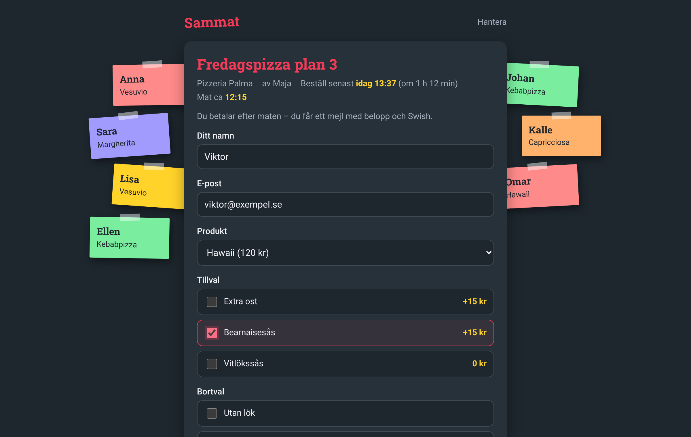

# SamMat

**Sambeställning av mat med Swish.** En liten självhostad webbapp för att samla ihop matbeställningar på jobbet, i föreningen eller på LAN:et.
Folk beställer själva utan konto, du får en färdig orderlista till restaurangen, och alla swishar rätt belopp.

📖 **Så funkar det, med bilder: https://lyzio.github.io/SamMat/**



## Funktioner

- **Vem som helst startar en runda** och får en länk att dela och en slumpad 4-siffrig PIN att hantera den med. Flera rundor kan pågå samtidigt.
- **Ingen inloggning för att beställa**: namn, e-post, rätt, tillval och bortval. Varje beställning blir en lapp på beställningssidan.
- **Polaroid**: lägg till en bild på din lapp, uppladdad eller som länk. Lappen blir en polaroid med gammal filmkänsla, och den följer med i betalningsmejlet som ett minne.
- **Dricka med antal**: dryck läggs till med +/−. På orderlistan samlas den längst ner, eftersom alla hämtar sin dryck själva.
- **Tillval per rätt**: tillval och bortval kan begränsas till vissa rätter.
- **Ändra eller avboka själv**: efter beställningen visas en länk som fungerar tills beställningen stänger. Webbläsaren kommer ihåg den.
- **Orderlista utan priser** att läsa upp, kopiera eller skriva ut, t.ex. `#1 (Anna) Vesuvio - Bearnaisesås - Utan lök`, plus en sammanställning per rätt.
- **Stopptid och datum**: rundan kan stänga av sig själv och mejla orderlistan till den som startade den. Den kan också bokas upp till 60 dagar i förväg.
- **Påminnelse med bekräfta/avboka**: dagen innan, samma morgon eller en egen tid.
- **Betala efter eller före**: betalningsmejl efter maten, med pris justerat efter kvittot, eller Swish direkt när man beställt.
- **Swish utan företagsavtal**: QR-kod (även inbäddad i mejlet) och `swish://`-länk med förifyllt belopp och meddelande.
- **Gemensam kostnad**, t.ex. utkörning, delas automatiskt lika på alla. Betalningar räknas i kronor, så ändras något i efterhand mejlas bara mellanskillnaden.
- **Automatisk betalpåminnelse** (valfri) till de som inte swishat, 2–48 timmar efter betalningsmejlet.
- **Samma som förra gången**: kryssar man i "kom ihåg" föreslås samma beställning nästa gång hos samma ställe. Det kräver både e-post och namn, och e-posten sparas bara som en HMAC-nyckel. `/integritet` förklarar vad som sparas och har "Glöm mig".
- **Webhooks** till Teams (Workflows, ingen Entra-admin behövs), Slack, Discord, ntfy, Apprise eller valfri JSON-mottagare: ny runda, runda stängd och maten är här.
- **Mejl** via valfri SMTP-server: *Maten är här*, betalningsmejl, påminnelser och orderlista.
- **Flera orter/kontor**: koppla varje ställe till en ort. Startsidan får en ortväljare, och webhooks kan skickas per ort. Utan inlagda orter syns inget av det.
- **Flera företag i samma hus** (t.ex. ett kontorshotell): en runda kan gälla ett företag eller *Alla i huset*. Startsidan får en företagsväljare, och webhooks kan skickas per företag. Det är ett filter, ingen spärr.
- **Installera som app** (PWA) från startsidan: en knapp i Chrome, Edge och Android, och en instruktion för Safari på iPhone, iPad och Mac.
- **Admin** (`/admin`, egen PIN): ställen, menyer, tillval/bortval och översikt över alla rundor. Klistra in en hel meny på en gång, och lägg in telefon, adress och menylänk per ställe.
- **Svenska och engelska**: SV/EN-knapp på alla sidor. Mejlen kommer på mottagarens språk.
- **Backup**: en säkerhetskopia per dygn i `data/backups/`, sparas i 7 dagar.
- **Rensar efter sig**: när en runda avslutas raderas namn och e-post på riktigt. Gamla rundor rensas automatiskt.

## Installera

Kräver Podman eller Docker och en reverse proxy med HTTPS (t.ex. Caddy).
Imagen byggs automatiskt till `ghcr.io/lyzio/sammat` (amd64 + arm64).

```bash
mkdir -p ~/sammat && cd ~/sammat
curl -LO https://raw.githubusercontent.com/lyzio/SamMat/master/deploy/sammat-compose.yaml
curl -L -o sammat.env https://raw.githubusercontent.com/lyzio/SamMat/master/deploy/sammat.env.example
curl -LO https://raw.githubusercontent.com/lyzio/SamMat/master/deploy/sammat.caddy
chmod 600 sammat.env && nano sammat.env

sudo mkdir -p /opt/container-data/sammat/data
sudo chown -R $(id -u):$(id -g) /opt/container-data/sammat

podman-compose -f sammat-compose.yaml up -d
```

Peka din reverse proxy på `127.0.0.1:8102`. Gå sedan till `/admin`, logga in med `ADMIN_PIN` och lägg in ställen och menyer.

**Uppdatera:** `podman-compose -f sammat-compose.yaml pull && podman-compose -f sammat-compose.yaml up -d`

### Inställningar (`sammat.env`)

| Variabel | Betydelse |
|---|---|
| `ADMIN_PIN` | PIN för `/admin`. Minst 4 tecken. |
| `PUBLIC_URL` | Publik adress, används i länkar i mejl. |
| `SMTP_HOST` / `SMTP_PORT` / `SMTP_USER` / `SMTP_PASS` | SMTP (valfritt). Port 465 = TLS, annars STARTTLS. Utan SMTP skickas inga mejl. |
| `MAIL_FROM` | Avsändare, t.ex. `SamMat <sammat@example.com>`. Måste vara verifierad hos mejltjänsten. |
| `PURGE_DAYS` | Rundor raderas så många dagar efter sitt datum (standard 7). |
| `MAX_ACTIVE_ROUNDS` | Max antal rundor samtidigt (standard 30). |
| `CREATE_PIN` | Kräv en PIN för att starta en runda (tomt = vem som helst kan). Den frågas efter först, innan formuläret. 4–8 siffror ger en ruta per siffra. |
| `BACKUP_DAYS` | Daglig backup i `data/backups/`, sparas så många dagar (standard 7, 0 = av). |
| `FLOW_TENANT_ID`, `FLOW_CLIENT_ID`, `FLOW_CLIENT_SECRET` | Entra-app för Teams Workflows när *Vem som helst* inte är tillåtet. Se *Teams via Workflows*. |
| `PHOTOS` | `0` stänger av bilder på lapparna (standard på). Uppladdade bilder sparas i `data/photos/` och raderas med rundan. |
| `ORDER_LIMIT` | Max antal nya beställningar per IP och 10 minuter (standard 20). |
| `FAVORITE_DAYS` | Hur länge "samma som förra gången" sparas efter senaste beställningen (standard 180). |

En rad per `NYCKEL=värde`, utan citattecken. Värdena läses när containern skapas, så kör `up -d --force-recreate` efter ändringar.

## API och webhooks

Öppna JSON-endpoints (samma som sidorna själva använder):

- `GET /api/rounds`: pågående rundor (titel, ställe, ort, datum, stopptid, antal beställningar) och listan med orter.
- `GET /api/rounds/<kod>`: en runda med meny och "lappar" (namn + rätt).
- `GET /healthz`: `ok`.

Webhooks ställs in under `/admin`. Format: `teams` (Adaptive Card för Teams *Workflows → Post to a channel when a webhook request is received*), `slack` (`{text}`), `discord` (`{content}`), `ntfy` (ämnets adress, t.ex. `https://ntfy.sh/lunch`), `apprise` (Apprise API, t.ex. `http://apprise:8000/notify/<nyckel>`) eller `json`. Inloggning kan skrivas i adressen: `https://user:pass@…` blir Basic, `https://:token@…` blir Bearer. Formatet `json` ser ut så här:

```json
{ "event": "round.created", "text": "🍕 Maja startar en sambeställning: …", "link": "https://…/r/abc123",
  "round": { "slug": "abc123", "title": "…", "place": "…", "location": "Stockholm", "company": "Acme AB", "creator": "…", "date": "2026-11-27", "closeAt": "…", "foodEta": "12:15", "isOpen": true } }
```

Händelser: `round.created`, `round.closed` och `food.arrived`.

### Teams via Workflows

**Vem kan utlösa arbetsflödet?**
- Om ni kan välja *Vem som helst* (Anyone) räcker det. Adressen innehåller en hemlig signatur, så behandla den som ett lösenord.
- Många organisationer har stängt av *Vem som helst*. Då kräver arbetsflödet en Entra-token, annars blir det `HTTP 401`. Be IT om en appregistrering och sätt i `sammat.env`:

  ```
  FLOW_TENANT_ID=<katalog-ID (tenant)>
  FLOW_CLIENT_ID=<program-ID (client) för appen>
  FLOW_CLIENT_SECRET=<klienthemlighet>
  ```

  SamMat hämtar då en token (client credentials, scope `https://service.flow.microsoft.com//.default`) och skickar den med alla webhooks till Power Automate/Workflows. Behörigheter i Graph behövs inte.
  I utlösaren väljer du *Specifika användare i min klientorganisation* och anger **objekt-ID för appens tjänsthuvudnamn** (Enterprise application → Object ID), eller behåller *Alla användare i min klientorganisation*.
  Om det ändå nekas: lägg till appen som medägare till arbetsflödet.

**Till en kanal:** använd mallen *Post to a channel when a webhook request is received* och formatet `teams`.

**Personligt meddelande till alla som beställt** (t.ex. när maten är här):
1. Kryssa i *Skicka med deltagarna* på webhooken i `/admin` (format `teams` eller `json`). Vid *Maten är här* och *Runda stängd* får anropet då en lista `people`:
   ```json
   "people": [{ "nr": 1, "name": "Anna", "email": "anna@firma.se", "order": "Vesuvio", "lang": "sv",
                "message": "🍽️ Maten från Pizzeria Palma är här! Din beställning: #1 Vesuvio" }]
   ```
2. Lägg till *Tillämpa på varje* (Apply to each) på `triggerBody()?['people']` i arbetsflödet.
3. Inuti den: *Publicera meddelande i en chatt eller kanal* (Post message in a chat or channel), med *Publicera som: Flödesrobot* och *Publicera i: Chatta med Flödesrobot*.
   Som *Mottagare*, skriv `items('Tillämpa_på_varje')?['email']`. Som *Meddelande*, skriv `items('Tillämpa_på_varje')?['message']`.
4. Varje persons e-post måste vara deras Teams-adress (UPN). *Testa* skickar en exempelperson med den e-post du anger.

Med detta lämnar e-postadresserna SamMat. Integritetssidan säger det automatiskt när funktionen är på.

**Privat till en person med vanlig text:** välj formatet `json` och skriv `concat(triggerBody()?['text'], ' ', triggerBody()?['link'])` som meddelandetext. Med *Utlösare: Brödtext* får man rå JSON.

### Apprise eller ntfy i en egen container

Kör du Apprise (eller ntfy) som en container som inte är exponerad utåt, kan SamMat ändå nå den. Lägg båda containrarna på ett gemensamt nätverk och använd containerns namn och interna port i webhook-adressen. Ingen port behöver publiceras.

```sh
podman network create notify        # en gång (eller: docker network create notify)
```

Lägg till nätverket i **båda** compose-filerna, alltså både SamMats och Apprises:

```yaml
services:
  sammat:                            # resp. apprise:
    networks: [default, notify]

networks:
  notify:
    external: true
```

Kör sedan `up -d` på båda. Webhook-adressen i `/admin` blir `http://apprise:8000/notify/<nyckel>`, där `apprise` är containerns namn (`container_name`) och `8000` är porten inne i containern, inte en publicerad port. För ntfy blir det t.ex. `http://ntfy:80/lunch`.

- Med rootless Podman måste båda containrarna köras av samma användare för att hamna på samma nätverk.
- `podman network connect notify apprise` fungerar också, men kopplingen försvinner när containern skapas om. Därför är det bättre att skriva in nätverket i compose-filen.
- Testa med knappen "Testa" vid webhooken. Får du `fetch failed` så hittar SamMat inte containern. Kontrollera då namn och nätverk med `podman network inspect notify`.

## Utveckla

```bash
npm install
ADMIN_PIN=0042 DB_PATH=./data/sammat.db node server.js   # http://localhost:3000
```

Bygga imagen lokalt: `podman build -t sammat -f Containerfile .`

Allt ligger i `server.js` (Express + better-sqlite3 + nodemailer) och `public/` (vanlig HTML/JS, inga byggsteg).

## Säkerhet och integritet

- PIN-koderna är korta. Efter 10 fel per IP eller 20 per runda spärras inloggningen i 15 minuter. De skyddar menyerna och enskilda rundor, inget mer.
- Högst 5 nya rundor per IP och timme.
- Avslutade rundor raderas med `secure_delete` och WAL-checkpoint, så att namn och e-post inte ligger kvar i filen.
- "Kom ihåg" är opt-in. E-posten sparas som HMAC med ett slumpat salt per installation, och uppslag kräver både e-post och namn.
- Inga externa resurser: typsnitten (Bangers, Bitter och Nunito Sans via `@fontsource`) serveras lokalt.

## Licens

[GNU Affero General Public License v3.0](LICENSE) eller senare. Kör du en ändrad version som en tjänst ska ändringarna också finnas tillgängliga för användarna.

Swish är ett varumärke som tillhör Getswish AB. SamMat har ingen koppling till Swish.
